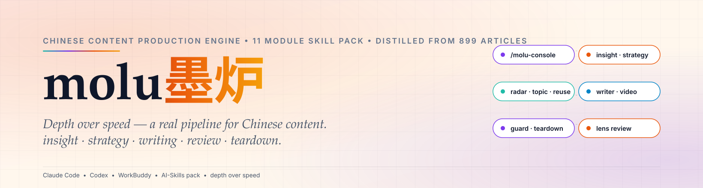

<div align="center">

<a href="https://github.com/Guislabert/molu">
  <picture>
    <source media="(prefers-color-scheme: dark)" srcset="assets/hero-dark.svg">
    
  </picture>
</a>

</div>

<h1 align="center">molu 墨炉</h1>

<div align="center">

> 以 **AI Agent Skills** 打包的中文内容生产引擎 —— 装 1 个包，用 11 个模块，从洞察到复盘。兼容 Claude Code、Codex、WorkBuddy 及其他 Skills 兼容 Agent。

</div>

<div align="center">

[][ci]
[][vlg]
[][osi]

`#内容引擎` `#AI技能` `#11模块` `#深度优先` `#中文内容`

</div>

> [!NOTE]
> 方法论由 899 篇公开公众号原文（2015-09 ~ 2018-12，213 万字）蒸馏而来，经实测提取 16,227 个内容单元，逐字校验命中率 100%。

<div align="center">

[English](README.md) | 简体中文

</div>

---

## 为什么（Why）

做中文内容是一连串孤立、需要反复重做的决策：你在写给谁？热点底下藏着什么永恒的痛点？用什么结构承载故事？发布安全吗？又为什么偏偏那篇爆了？写作工具帮你**打字更快**，几乎没人帮你**判断更准**。

> **墨炉 molu 是决策管道，不是文本生成器。** 深度优先：把一条内容任务变成从洞察到审核的可校验管道。

## 是什么（What）

molu 是一款**中文内容生产引擎**，以 11 个 AI Agent Skills 打包，覆盖洞察研究、策略定位、热点选题、写作、发布前审核与爆款拆解——可安装进任何支持 Skills 的 AI Agent。

核心信念：**深度优先（depth over speed）**。抓到一个热点，先问底下是什么永恒痛点；生成选题之前，先确认你在为谁而写；写完必须过审。它不是流量预测器——它交付可校验的方法，而非数字承诺。

## 管道（Pipeline）

```
  原料层  Corpus Source（可插拔换源，引擎零改动）
    写作方法论(4A·咨询框架) · 素材库(16,227 单元) · 实时热榜
                ↓
         kb.py · 统一数据层
                ↓
  主管道  Pipeline（①→⑤ 顺序执行）
     ① 洞察 insight → ② 策略 strategy → ③ 雷达 radar
     → ④ 选题 topic/reuse → ⑤ 生产 writer/video
                ↓
  收束层
     ⑥ 审核 guard → ⑦ 拆解 teardown ⇄ 回到 ①
     ⑧ lens ◈ 视角 —— 贯穿全程
```

## 模块（Modules）

| # | 模块 | 作用 |
|---|---|---|
| ① | [`/molu-console`](molu/console/SKILL.md) | 展示管道地图、诊断当前阶段、调度模块 |
| ② | [`/molu-insight`](molu/insight/SKILL.md) | 区分观察与洞察，四层拆解读者卡点 |
| ③ | [`/molu-strategy`](molu/strategy/SKILL.md) | 定义定位、读者、节奏、形式——含「不做什么」 |
| ④ | [`/molu-radar`](molu/radar/SKILL.md) | 采集实时热榜、过滤红线、输出可写角度 |
| ⑤ | [`/molu-topic`](molu/topic/SKILL.md) | 20 个选题，每条带读者与依据 |
| ⑤ | [`/molu-reuse`](molu/reuse/SKILL.md) | 一个主题十个角度，五种换角度法 |
| ⑥ | [`/molu-writer`](molu/writer/SKILL.md) | 按平台规格产出可发布长文/图文 |
| ⑥ | [`/molu-video`](molu/video/SKILL.md) | 前 3 秒钩子、分镜节奏、字幕切分 |
| ⑦ | [`/molu-guard`](molu/guard/SKILL.md) | 法律/伦理/平台三层审核，三档结论，只读 |
| ⑧ | [`/molu-teardown`](molu/teardown/SKILL.md) | 12 指标 + 百分位定位，基于实测基线 |
| ◈ | [`/molu-lens`](molu/lens/SKILL.md) | 用从业者标准复盘写作决策，贯穿全程 |

## 安装

请在终端执行（不要把安装命令当作聊天内容发给 Agent）。

### Skills CLI

```bash
npx -y skills add Guislabert/molu -g --all
```

`-g` 全局安装；`--all` 安装进 CLI 识别的所有 Agent。若只要单个 Agent，去掉 `--all`。

### install.sh

```bash
bash install.sh agents           # 装入源（~/.agents/skills）
bash install.sh all              # 源 + 软链到 pi / claude / codex
```

安装完成后，在 Agent 聊天中输入：

```text
/molu-console what does this do
```

## 快速开始

1. **首次运行** —— 认识入口：

   ```text
   /molu-console what does this do
   ```
   控制台会画出管道、列出全部 11 个模块、判断你卡在哪一步，并给出最小的下一步行动。

2. **已经知道要什么** —— 直接调用模块：

   ```text
   /molu-topic  我写省钱类职场年轻人内容。给我 20 个可直接写的选题，每条带角度与依据。
   /molu-writer 这是我的选题和素材。按公众号规格写一篇可发布的稿子。
   /molu-guard  这篇要发公众号。跑一遍发布前审核，标出风险点。
   /molu-teardown 拆解这篇 10w+ 为什么爆，并指出我的差距。
   ```

3. **连接语料源（可选）** —— 方法论开箱即用；接入源后 topic / reuse / teardown 可引用实测素材：

   ```bash
   python3 molu/kb.py stats
   python3 molu/kb.py install <id>
   ```

4. **同一对话内续改** —— 补充新事实即可；任何成稿发布前都要过 `/molu-guard`。

## 采纳与贡献（Adopting / Contributing）

完整引擎文档见 [`molu/README.md`](molu/README.md)。版本纪律遵循 [SemVer 2.0.0](https://semver.org/)，由 `tools/version-check.mjs` 守卫。

方法论来源与框架致谢（含 [dontbesilent2025/dbskill](https://github.com/dontbesilent2025/dbskill)）在下方 **许可证** 一节详列。

## 反馈

Bug、模块想法或方法问题，请在 issue 提出。

[ci]: https://github.com/Guislabert/molu/actions
[vlg]: CHANGELOG.md
[osi]: https://creativecommons.org/licenses/by-nc/4.0/

## 许可证

本项目方法论采用 [CC BY-NC 4.0](https://creativecommons.org/licenses/by-nc/4.0/) —— 个人学习与研究的非商用使用必须署名；商用需联系作者授权。

**内容边界**：本仓库不含逐字语料。用本引擎创作并发布内容时，请用自己的原创措辞；不虚构案例、不承诺流量数字。